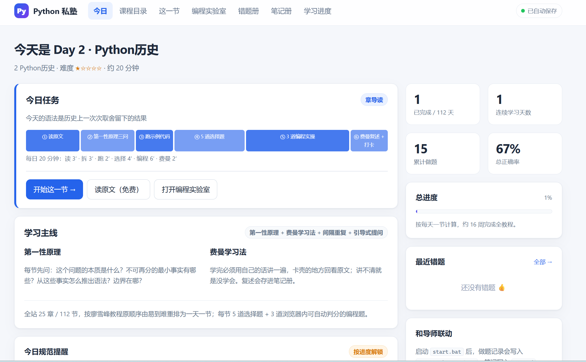
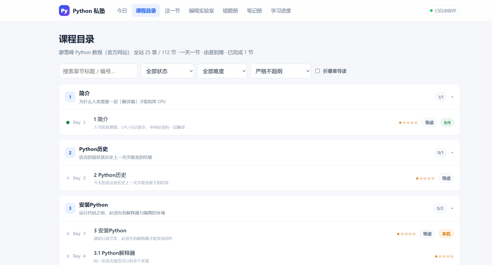
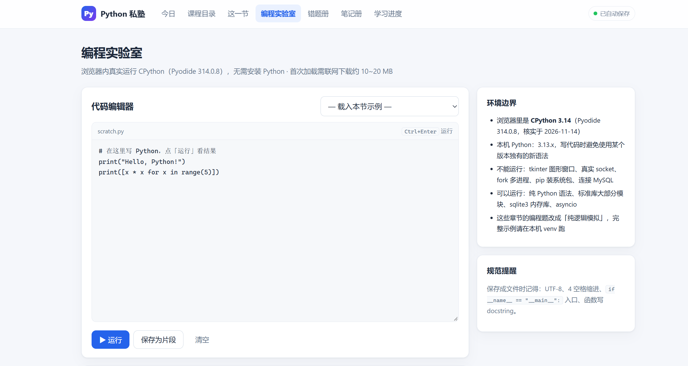
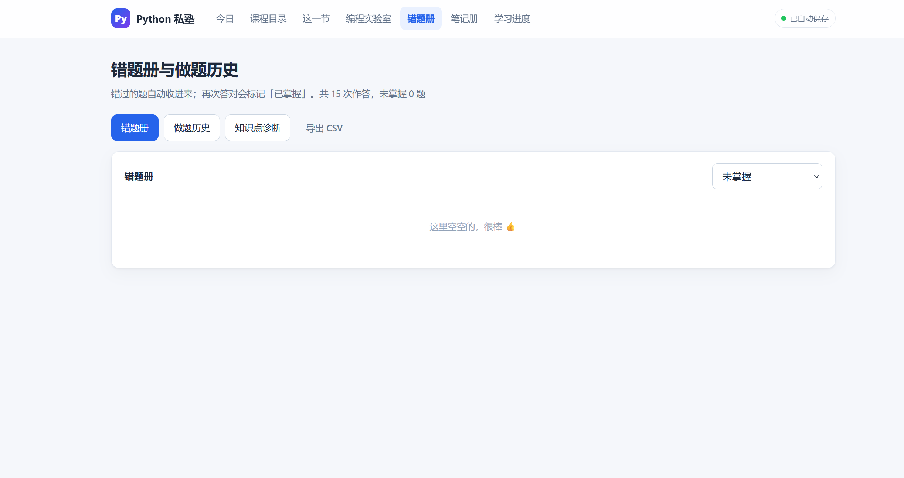
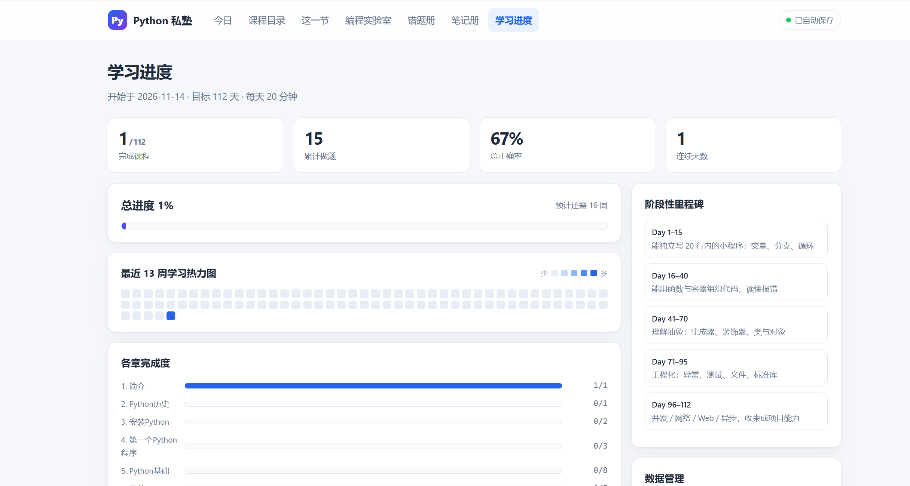
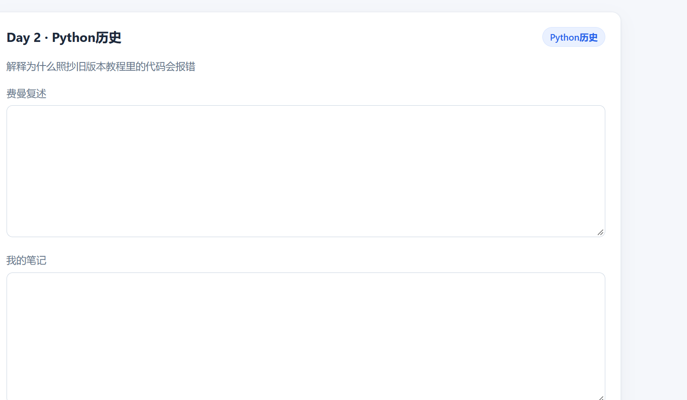

# Python 私塾 · 源码快照

> 把廖雪峰 Python 教程全站内容拆成 **112 天、每天约 20 分钟** 的私人学习站：用第一性原理拆概念，用费曼复述检验理解，题目按知识点解锁日递进，浏览器内直接写 Python 并自动判题。

这是**源码快照，不是在线站点**。clone 到本地后双击 `start.bat` 就能跑，所有学习数据只留在你自己的电脑上。仓库里**不含任何个人作答记录或笔记**。

## 界面预览



<details>
<summary>展开查看其余页面（课程目录 / 编程实验室 / 错题册 / 笔记册 / 学习进度）</summary>

| 课程目录 | 编程实验室 |
| :---: | :---: |
|  |  |

| 错题册与做题历史 | 学习进度 |
| :---: | :---: |
|  |  |

**笔记册局部特写** — 费曼复述与「我的笔记」输入框（输入过程实时自动保存，无需点保存）：



</details>

> 截图取自实际运行界面（截至 Day 2），其中的进度与答题统计为展示性数据；仓库不含 `records/`、`notes/` 中的个人记录，笔记册截图已裁去导师回信栏。

---

## 一、它解决什么问题

自学教程常见两个坑：一是「看懂了」但讲不出来，二是练习题突然冒出还没学过的概念，被迫去搜。这个站用两件事应对：

- **第一性原理卡**：每节先问「本质问题」→ 给「最小事实」→ 留「推导提问」→ 标「边界/易错」，从最少的事实把概念推出来。
- **费曼复述**：学完用自己的话说一遍，写给导师看；输入过程中每个字都会自动保存，没点保存也不会丢。
- **不超纲**：每个知识点有解锁日，出题硬过滤 `unlock ≤ 当前天`；每题标注「本题用到… / Day N 起可答」，还有「这题没学过？」反馈。Day 1 不会撞上 `def`、`return`、`pip`。

## 二、每天 20 分钟

| 环节 | 时间 | 内容 |
| --- | --- | --- |
| 读原文 | 3′ | 当天那一节教程 |
| 第一性原理 | 3′ | 本质问题 / 最小事实 / 推导 / 边界 |
| 跑示例 | 2′ | 浏览器里实跑本节示例 |
| 选择题 | 3~5 道 | 只考已学知识点，数量随章节难度递增 |
| 编程实操 | 1~3 道 | 写代码、看输出、自动判题，数量随章节难度递增 |
| 费曼复述 + 打卡 | 0 或 1 题 | 只在有重点概念的节安排复述，其余节直接打卡 |

## 三、功能

- **7 个页面**：今日任务、课程目录、每日学习、编程交互、错题册、学习进度、笔记册。
- **浏览器内真跑 Python**：Pyodide `v314.0.8`（CPython 3.14），捕获 `stdout` / `stderr` 判题，`Ctrl+Enter` 执行；不需要装 Python 环境也能写代码。
- **题库**：112 天按章节难度配置题量，共 419 个选择位 + 223 个编程位 + 33 个费曼复述位；配置写在每节 `plan` 字段。另有零基础入门题池（44 选择 + 36 道「照着写 `print` 看输出」）。
- **判题不刁难格式**：字符串照抄题忽略空格、`'` 与 `"` 等价；计算结果与容器输出严格比对。
- **实时自动保存**：250ms 防抖写入，页面隐藏/关闭时强制同步；服务端按记录身份合并，不会被空白页面覆盖。
- **PEP 8 规范渐进解锁**，不提前堆术语。

## 四、快速开始

```bat
REM Windows：双击 start.bat
python launcher.py
```

打开 `http://127.0.0.1:8765/`。

- 服务端只用 Python 标准库 `http.server`，无需 `pip install`，需要本机有 Python 3。
- 首次打开编程页需联网从 jsDelivr 下载 Pyodide（之后走浏览器缓存）；读课程与做题可离线，但**自动保存需要本地服务在运行**。
- `server.py` 首次运行会自动创建 `records/` 与 `notes/`。这两个目录是你自己的私人数据，已被 `.gitignore` 排除，请勿提交。

## 五、数据放在哪里

| 路径 | 内容 |
| --- | --- |
| `records/state.json` | 权威状态：作答、进度、错题、笔记、草稿 |
| `records/drafts.md` | 未点保存的输入，供导师读取 |
| `records/mentor-replies.json` | 导师回信，会显示在学习页 |
| `notes/*.md` | 笔记库，可用 Obsidian 直接打开整个目录 |

前端 `localStorage` 与服务端文件双写；`records/` 与 `notes/` 由 `.gitignore` 排除，所以这份公开快照是干净的。

## 六、目录结构

```
├── index.html  catalog.html  lesson.html  playground.html
├── review.html  progress.html  notes.html      # 7 个页面
├── assets/
│   ├── app.js  app.css  py-runner.js          # 应用逻辑 / 样式 / 判题
│   ├── config.js                             # 集成配置 + 三个适配器 + 设置面板
│   └── data/
│       ├── course.js  toc.json                # 112 天课程数据、原站目录
│       ├── question-bank.js  entry-bank.js    # 主题库、零基础入门题池
├── server.py  launcher.py  start.bat          # 本地服务与一键启动
├── python-tutor.ico
├── docs/screenshots/                         # 运行界面截图
├── CHANGELOG.md                              # 开发日志：决策、缺陷定位与修正
└── tools/
    ├── build_course.py  build_pages.py        # 从课程数据重建页面
    ├── verify.py  open_folder.py              # 自检、打开目录
```

## 七、自检

```bash
python tools/verify.py
```

校验 112 天组卷与当天题量一致、超纲与提前术语、题池重复、223 个判题脚本的参考解答，以及引号/空格等价等用例。

## 八、集成设置：存储 / 笔记 / 导师都能换

顶栏右侧的「设置」按钮打开配置面板。**默认值与未改造版本完全一致**：自动探测本地服务、笔记写 `notes/`、导师读 `records/`。不碰任何配置也能按原来的方式使用。

| 分组 | 可选值 | 说明 |
| --- | --- | --- |
| 进度存储 | `auto`（默认） | 先探测本机服务，没运行就退回浏览器本地 |
| | `browser` | 不发任何网络请求，进度只存这台设备 |
| | `cloud` | 填 endpoint，需自行实现 `/api/state`、`/api/mentor` 等接口；可填 Bearer token |
| 笔记导出 | `obsidian`（默认） | 由本地服务写 `notes/*.md` |
| | `off` | 不导出、不生成笔记文件，适合不用 Obsidian 的人 |
| | `download` | 打包成 `.md` 下载，完全不依赖 Obsidian |
| | `webhook` | 把 `{ files }` POST 到自己的笔记服务 |
| 导师 | `local`（默认） | 站点读 `/api/mentor`，WorkBuddy 读 `records/` |
| | `off` | 不显示导师回信 |
| | `agent` | 接自己的 AI agent，见下方协议 |

**自有 AI Agent 协议**（实现在 `assets/config.js` 的 `MentorAdapter`）：

```
GET  endpoint  -> { "replies": [{ "text": "...", "ts": "ISO 时间" }] }
POST endpoint  <- { day, lessonId, question, kind, drafts, attempts }
```

页面加载时 GET 拉回信，发布 Comments 提问时 POST。浏览器直连第三方服务需对方允许 CORS；不通时把导师设为 `off` 或 `local`，改用复制/粘贴。

**隐私与边界**：

- 全部配置（含 token）只存当前浏览器 `localStorage`（`pyfirst.integrations.v1` / `pyfirst.secrets.v1`），**不进 `state.json`、不进 `records/`、不进仓库，也不随进度同步**。导出备份、push 代码都不会带上密钥。
- 换设备或换浏览器，配置不跟着走，这是有意为之。
- 配置只影响「外部集成」；课程、题库、判题、费曼复述、进度逻辑一行没改。
- 本版仍是**本地运行的源码**，没有做在线发布；即便存储模式选 `cloud`，也要你自己提供那个服务。

实现位置：`assets/config.js`（默认值 + 三个适配器 + 设置面板），`app.js` 里收拢的 `apiBases()` / `apiHeaders()` / `Store.loadMentor()` / `syncNotes()`。重新生成页面请跑 `python tools/build_pages.py`，模板里已包含 `config.js`，不会丢。

## 九、边界与说明

- **纯本地、单人**：没有账号、云同步或多人隔离；不同设备的数据互不相通。本仓库也不是可直接访问的在线网站。
- **题库含答案**：`question-bank.js` / `entry-bank.js` 里能看到参考解答，公开源码仅作展示与学习参考。
- **课程依据**：内容依据 [廖雪峰 Python 教程](https://liaoxuefeng.com/books/python/introduction/index.html) 全站 25 章 / 112 页编排，原文版权归原作者所有。本仓库只保存本地编排的学习提纲、示例与自编题目，不含原文全文，阅读原文请到原站。
- 这是一个为个人学习习惯定制的项目，不是通用教程产品；如要改成自己的节奏，改 `assets/data/course.js` 后跑 `tools/build_pages.py` 重新生成页面即可。

---

技术栈：原生 HTML / CSS / JavaScript（无框架、无构建）+ Python 标准库 + Pyodide。

开发过程、每一轮缺陷的定位与修正、以及 AI 协作的边界，见 [CHANGELOG.md](CHANGELOG.md)。
